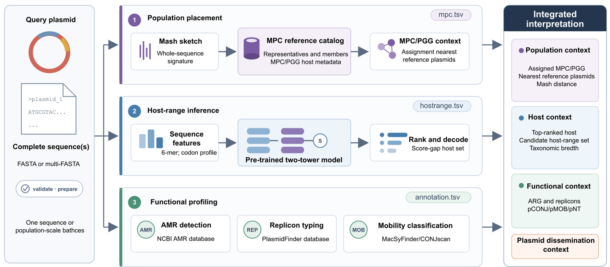

# PlasRiP

[](https://anaconda.org/changan522/plasrip)
[](LICENSE.txt)
[](#installation)
[](#installation)

**PlasRiP** is a Linux-based plasmid analysis platform for **candidate host-spectrum prediction**, **Mash-based plasmid cluster (MPC) assignment**, **plasmid genome group (PGG) contextualization**, and optional plasmid functional annotation.

Starting from one or more plasmid FASTA files, PlasRiP integrates candidate host-spectrum prediction, MPC/PGG assignment, antimicrobial-resistance (AMR) gene screening, replicon typing, mobility prediction, and final report generation into a single command-line workflow.

> **Software version:** v0.3.0  
> **Reference database:** PlasRiP Reference Database v3.0  
> **Primary command:** `plasrip`  
> **Main workflow:** `plasrip run`

---

## Contents

- [Key features](#key-features)
- [Workflow overview](#workflow-overview)
- [Installation](#installation)
- [Required reference database](#required-reference-database)
- [Quick start](#quick-start)
- [Command-line usage](#command-line-usage)
- [Input requirements](#input-requirements)
- [Models and resources](#models-and-resources)
- [Output files](#output-files)
- [Troubleshooting](#troubleshooting)
- [Python API](#python-api)
- [Developer and maintainer notes](#developer-and-maintainer-notes)
- [Citation](#citation)
- [License](#license)
- [Contact](#contact)

---

## Key features

- **Candidate host-spectrum prediction** using a bundled pre-trained two-tower model
- **MPC assignment** using Mash-based comparison against the versioned PlasRiP reference database
- **PGG contextualization** for MPCs that belong to higher-order plasmid genome groups
- **Observed MPC host context** reported separately from model-predicted host spectra
- **AMR detection** using ABRicate-compatible databases
- **Replicon typing** using PlasmidFinder/ABRicate-style screening
- **Mobility prediction** using Prodigal and MacSyFinder/CONJscan-based detection
- **Compact 25-column `summary.tsv`** for routine interpretation, with detailed diagnostics retained in module-specific outputs
- **Versioned external reference database** with schema validation and Mash-index compatibility checks

---

## Workflow overview



PlasRiP accepts plasmid FASTA or multi-FASTA files, validates the input, and performs two core analyses: **model-based candidate host-spectrum prediction** and **database-backed MPC assignment**. Assigned MPCs are linked to PGGs when applicable. Optional annotation modules then detect AMR genes, plasmid replicons, and mobility systems. Module-level outputs are merged into an integrated final summary.

The two host concepts are intentionally separated:

- `Predicted_*` fields describe the **model-predicted host spectrum of the query plasmid**.
- `MPC_observed_*` fields describe the **observed host distribution of reference plasmids belonging to the assigned MPC**.

---

## Installation

PlasRiP is designed for Linux. **Conda is the recommended installation method** because it installs PlasRiP together with the required external bioinformatics tools.

### Recommended: Conda

Create a dedicated environment and install PlasRiP v0.3.0:

```bash
conda create -n plasrip \
  --override-channels \
  -c changan522 \
  -c conda-forge \
  -c bioconda \
  python=3.11 plasrip=0.3.0 -y
```

Activate the environment:

```bash
conda activate plasrip
```

Verify the installation:

```bash
plasrip version
plasrip --help
plasrip models --json
```

Expected version:

```text
0.3.0
```

The Conda package resolves the required runtime tools, including **Mash 2.3**, ABRicate, Prodigal, and MacSyFinder.

For ABRicate-based modules, confirm that the required databases are available:

```bash
abricate --list
```

### Alternative: install the GitHub wheel

The wheel attached to the GitHub v0.3.0 release provides an alternative installation with `pip`. Download and verify it before installation:

```bash
wget https://github.com/changan522/PlasRiP/releases/download/v0.3.0/plasrip-0.3.0-py3-none-any.whl
wget https://github.com/changan522/PlasRiP/releases/download/v0.3.0/plasrip-0.3.0-py3-none-any.whl.sha256
sha256sum -c plasrip-0.3.0-py3-none-any.whl.sha256
python -m pip install ./plasrip-0.3.0-py3-none-any.whl
plasrip version
```

The wheel includes the pretrained model and CONJScan resources. Python dependencies are installed by `pip`; external bioinformatics tools such as Mash 2.3, ABRicate, Prodigal, and MacSyFinder must be installed separately.

The wheel download URLs and source tag become available after the GitHub `v0.3.0` Release is published.

### Installation from source

```bash
git clone --branch v0.3.0 https://github.com/changan522/PlasRiP.git
cd PlasRiP
conda env create -f environment.yml
conda activate plasrip
python -m pip install . --no-deps
```

For editable development mode:

```bash
python -m pip install -e . --no-deps
```

---

## Required reference database

MPC assignment and PGG contextualization require the external **PlasRiP Reference Database v3.0**. The database is versioned independently from the software and is not bundled inside the Python/conda package.

MPC denotes a Mash-based plasmid cluster and does not claim equivalence with the published plasmid taxonomic unit framework. Software v0.3.0 requires the MPC-named database v3.0 (metadata schema 2.0). It uses `--mpc-threshold` and `--mpc-mash` in the CLI, and `run_mpc_assignment`, `mpc_threshold`, and `mpc_mash` in the Python API. Cluster membership, Mash settings, model weights, and assignment logic are unchanged.

Database release page:

<https://github.com/changan522/PlasRiP/releases/tag/database-v3.0>

The v3.0 database contains:

- 64,391 reference plasmids
- 52,591 plasmids assigned to 5,975 MPCs
- 11,800 reference plasmids without stable MPC assignment
- 4,152 MPCs organized into 185 PGGs

### Download

```bash
mkdir -p ~/plasrip_resources
cd ~/plasrip_resources

wget https://github.com/changan522/PlasRiP/releases/download/database-v3.0/PlasRiP_reference_database_v3.0.zip
wget https://github.com/changan522/PlasRiP/releases/download/database-v3.0/PlasRiP_reference_database_v3.0.zip.sha256
```

Verify the downloaded archive:

```bash
sha256sum -c PlasRiP_reference_database_v3.0.zip.sha256
```

A successful check should report:

```text
PlasRiP_reference_database_v3.0.zip: OK
```

Extract the database:

```bash
unzip PlasRiP_reference_database_v3.0.zip
```

The database root should contain:

```text
PlasRiP_reference_database_v3.0/
├── mash_index/
├── plasmid_reference_index.tsv
├── MPC_metadata.tsv
├── PGG_metadata.tsv
├── database_manifest.tsv
├── database_QC_report.tsv
├── checksums.sha256
└── README.md
```

### Configure the database path

Option 1 — set the environment variable once per shell/session:

```bash
export PLASRIP_DATABASE=~/plasrip_resources/PlasRiP_reference_database_v3.0
```

Option 2 — provide the database explicitly to MPC-related commands:

```bash
--database ~/plasrip_resources/PlasRiP_reference_database_v3.0
```

Validate database metadata and representative sketches:

```bash
plasrip database --check
```

Validate the complete Mash index:

```bash
plasrip database --check --deep
```

The database manifest fixes the reference Mash configuration (Mash 2.3, k=21, sketch size=1000, seed=42). Query sketches are checked against these parameters before MPC assignment.

---

## Quick start

### 1. Check software and database

```bash
plasrip version
plasrip models --json
plasrip database --check
```

### 2. Run the full workflow

With `PLASRIP_DATABASE` already set:

```bash
plasrip run \
  -i examples/plasmid_genomes/pCZ2103-1.fasta \
  -o run_out \
  -t 8
```

Or specify the database explicitly:

```bash
plasrip run \
  -i examples/plasmid_genomes/pCZ2103-1.fasta \
  --database ~/plasrip_resources/PlasRiP_reference_database_v3.0 \
  -o run_out \
  -t 8
```

Disable optional annotation modules if needed:

```bash
plasrip run \
  -i examples/plasmid_genomes/pCZ2103-1.fasta \
  --database ~/plasrip_resources/PlasRiP_reference_database_v3.0 \
  -o run_out \
  --no-amr \
  --no-replicon \
  --no-mobility
```

### 3. Inspect the main output

```bash
cat run_out/summary.tsv
```

`summary.tsv` is intentionally compact (25 columns). Detailed host-prediction diagnostics remain in `hostrange.tsv`; MPC assignment evidence remains in `mpc.tsv`; detailed MPC/PGG reference context remains in `core_summary.tsv`.

---

## Command-line usage

The recommended command-line entry point is:

```bash
plasrip
```

Available subcommands:

| Command | Purpose |
|---|---|
| `plasrip run` | Run the full integrated workflow |
| `plasrip predict` | Predict plasmid host range |
| `plasrip assign` | Assign plasmids to MPCs and report PGG context |
| `plasrip core` | Run host-range prediction plus MPC/PGG assignment |
| `plasrip annotate` | Run AMR, replicon, and mobility annotation |
| `plasrip database` | Validate and inspect a reference database |
| `plasrip version` | Print version information |
| `plasrip models` | Inspect dependency, model, and database availability |

Legacy executable names are retained where applicable for compatibility, but `plasrip` is recommended.

### Host-range prediction only

The bundled host-range model is discovered automatically, so `--model-dir` is not required for the default model.

```bash
plasrip predict \
  -i examples/plasmid_genomes/pCZ2103-1.fasta \
  -o predict_out \
  -t 8
```

Use `--model-dir` only for a custom host-range model.

### MPC/PGG assignment only

```bash
plasrip assign \
  -i examples/plasmid_genomes/pCZ2103-1.fasta \
  --database ~/plasrip_resources/PlasRiP_reference_database_v3.0 \
  -o mpc.tsv \
  -t 8
```

The MPC cutoff defaults to the value stored in `database_manifest.tsv`. It can be supplied explicitly when required:

```bash
--mpc-threshold 0.05
```

### Core analysis

```bash
plasrip core \
  -i examples/plasmid_genomes/pCZ2103-1.fasta \
  --database ~/plasrip_resources/PlasRiP_reference_database_v3.0 \
  -o core_out \
  -t 8
```

### Annotation-only workflow

```bash
plasrip annotate \
  -i examples/plasmid_genomes/pCZ2103-1.fasta \
  -o annotation_out \
  -t 8
```

### Reference-database validation

```bash
plasrip database --check ~/plasrip_resources/PlasRiP_reference_database_v3.0
```

Full Mash-index validation:

```bash
plasrip database --check ~/plasrip_resources/PlasRiP_reference_database_v3.0 --deep
```

---

## Input requirements

PlasRiP accepts FASTA or multi-FASTA input. Each input file must contain at least one FASTA record beginning with `>`.

Examples:

```bash
plasrip run -i plasmid.fasta -o run_out
```

```bash
plasrip run -i plasmid1.fasta plasmid2.fasta -o run_out
```

PlasRiP validates missing, empty, malformed, and unexpanded wildcard input paths before analysis.

MPC-related commands (`assign`, `core`, and `run`) require either:

- `--database /path/to/PlasRiP_reference_database_v3.0`, or
- the `PLASRIP_DATABASE` environment variable.

---

## Models and resources

### Host-range model

The default host-range model is bundled under:

```text
plasrip/data/hostrange/
```

Required model files include:

- `two_tower_best_3.2.pth`
- `host_profiles.joblib`
- `host_vocab.joblib`
- `plasmid_codon_scaler.joblib`

Model-directory resolution follows this priority:

1. `--model-dir <DIR>`
2. `PLASRIP_MODEL_DIR`
3. bundled `plasrip/data/hostrange`

### MPC/PGG reference resources

MPC/PGG metadata are **not bundled in the software package** in v0.3.0. They are provided by the external versioned reference database:

- `mash_index/`
- `plasmid_reference_index.tsv`
- `MPC_metadata.tsv`
- `PGG_metadata.tsv`
- `database_manifest.tsv`

Database release:

<https://github.com/changan522/PlasRiP/releases/tag/database-v3.0>

### External tools

The following command-line tools are used by PlasRiP:

- `mash` — MPC assignment
- `abricate` — AMR and replicon screening
- `prodigal` — ORF prediction
- `macsyfinder` — mobility prediction

The v3.0 reference database was generated with **Mash 2.3**.

---

## Output files

Typical outputs include:

| Output | Description |
|---|---|
| `hostrange.tsv` | Detailed model-based host-range prediction |
| `hostrange.top_hits.tsv` | Top-ranked host candidates |
| `hostrange.taxonomy.tsv` | Taxonomic summary of predicted hosts |
| `hostrange.set.tsv` | Predicted host-set output |
| `mpc.tsv` | MPC assignment plus PGG ID/status |
| `mpc.tsv.hits.tsv` | Candidate MPC hit-level results |
| `amr.tsv` | AMR gene hits |
| `plasmidfinder.tsv` | Replicon/Inc-type hits |
| `mobility_summary.tsv` | Mobility prediction summary |
| `core_summary.tsv` | Detailed host prediction plus MPC/PGG reference context |
| `annotation_summary.tsv` | Integrated functional-annotation summary |
| `summary.tsv` | Compact 25-column final integrated report |
| `PlasRip.log` | Workflow log |

The final `summary.tsv` columns are:

```text
PLASMID
Predicted_host_top1
Predicted_host_top1_score
Predicted_host_set
Predicted_host_set_size
Predicted_host_range_class
MPC
PGG_ID
PGG_assignment_status
MPC_assignment_method
MPC_candidate_hits
MPC_closest_rep_dist
MPC_n_plasmids
MPC_observed_host_range_rank
MPC_observed_dominant_taxon
MPC_observed_n_host_species
MPC_observed_top_host_species
MPC_observed_top_host_species_coverage
MPC_dominant_replicon
MPC_dominant_mobility
AMR_hits
AMR_genes
REPLICON_hits
REPLICON_genes
MOB
```

`Predicted_host_confidence` is not reported in v0.3.0; raw model scores and host-set outputs are retained instead.

---

## Troubleshooting

### Reference database not found

Set:

```bash
export PLASRIP_DATABASE=/path/to/PlasRiP_reference_database_v3.0
```

or provide `--database` explicitly.

Then run:

```bash
plasrip database --check
```

### Database or Mash sketch incompatibility

Run:

```bash
plasrip database --check --deep
```

PlasRiP validates database schema and Mash parameters before MPC assignment. The v3.0 reference index expects Mash 2.3 with k=21, sketch size=1000, and seed=42.

### Host-range model directory not found or incomplete

```bash
plasrip models --json
```

If using a custom model, confirm that the required `.pth` and `.joblib` files are present.

### External dependency missing

```bash
which mash
which abricate
which prodigal
which macsyfinder
```

The external executables are not installed by `pip` itself; use conda/bioconda as described under [Installation](#installation).

### ABRicate database unavailable

```bash
abricate --list
```

Confirm that the AMR and PlasmidFinder databases required by your workflow are available in the active environment.

---

## Python API

The v0.3.0 package exposes the reference-database interface and major workflows:

```python
import plasrip

report = plasrip.validate_reference_database(
    "/path/to/PlasRiP_reference_database_v3.0"
)

result = plasrip.run_pipeline(
    input_fastas=["plasmid.fasta"],
    database_dir="/path/to/PlasRiP_reference_database_v3.0",
    out_dir="run_out",
)
```

The exported database helpers include:

- `PlasRipReferenceDatabase`
- `load_reference_database`
- `validate_reference_database`

---

## Developer and maintainer notes

Run the test suite in a Python 3.11 environment:

```bash
pytest -q
```

Build wheel and source distribution:

```bash
python -m pip install build
python -m build
```

Local conda build:

```bash
conda install -n base -c conda-forge conda-build anaconda-client
conda build conda.recipe
```

Project layout:

```text
PlasRiP/
├── src/plasrip/               # main Python package
├── src/plasrip/data/          # bundled host model and CONJScan resources only
├── examples/                  # example plasmid FASTA files
├── tests/                     # test suite
├── scripts/                   # validation/release helpers
├── conda.recipe/              # conda recipe
├── docs/images/               # README figures
├── environment.yml
├── pyproject.toml
├── README.md
├── CHANGELOG.md
├── RELEASE_NOTES_v0.2.0.md
├── RELEASE_NOTES_v0.2.1.md
├── RELEASE_NOTES_v0.3.0.md
└── VERSION
```

The MPC/PGG reference database is intentionally maintained outside `src/plasrip/data/`.

---

## Citation

A formal citation will be added when the associated manuscript is published. Until then, please cite the PlasRiP GitHub repository and the software/database versions used in the analysis.

Software repository:

<https://github.com/changan522/PlasRiP>

Reference database v3.0:

<https://github.com/changan522/PlasRiP/releases/tag/database-v3.0>

---

## License

PlasRiP is released under the MIT License. See [LICENSE.txt](LICENSE.txt) for details.

---

## Contact

**Maintainer:** Chang'an Li  
**Repository:** <https://github.com/changan522/PlasRiP>
