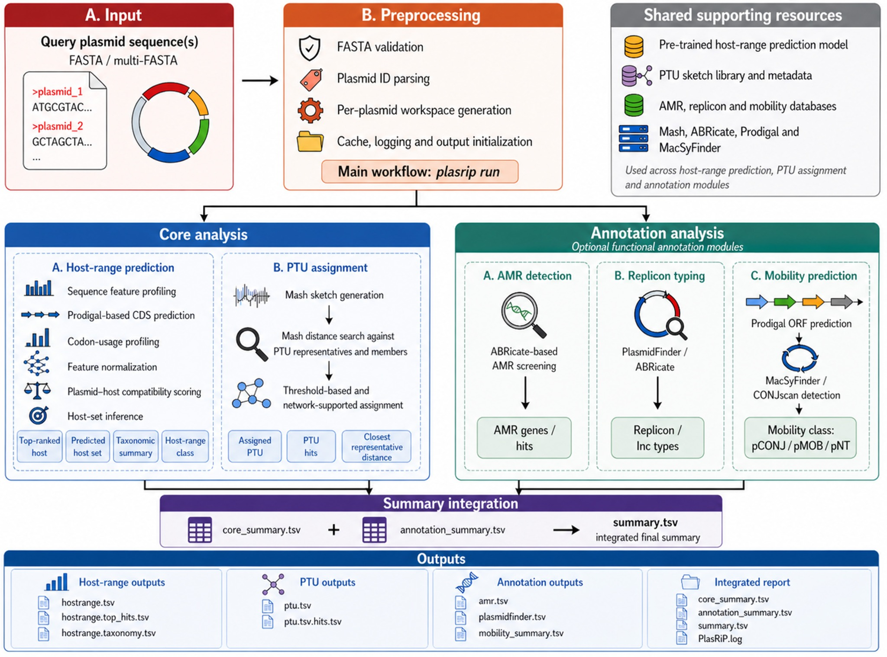

# PlasRiP

[](https://anaconda.org/changan522/plasrip)
[](LICENSE.txt)
[](#installation)
[](#installation)

**PlasRiP** is a Linux-based plasmid analysis platform for **host-range prediction**, **plasmid taxonomic unit (PTU) assignment**, and optional plasmid functional annotation.

Starting from one or more plasmid FASTA files, PlasRiP integrates host-range prediction, PTU assignment, AMR gene screening, replicon typing, mobility prediction, and final report generation into a single command-line workflow.

> **Current release:** v0.1.1  
> **Recommended installation:** conda  
> **Primary command:** `plasrip`  
> **Main workflow:** `plasrip run`

---

## Contents

- [Key features](#key-features)
- [Workflow overview](#workflow-overview)
- [Installation](#installation)
- [Required external resource: PTU sketch library](#required-external-resource-ptu-sketch-library)
- [Quick start](#quick-start)
- [Command-line usage](#command-line-usage)
- [Input requirements](#input-requirements)
- [Models and resources](#models-and-resources)
- [Output files](#output-files)
- [Troubleshooting](#troubleshooting)
- [Developer and maintainer notes](#developer-and-maintainer-notes)
- [Citation](#citation)
- [License](#license)
- [Contact](#contact)

---

## Key features

- **Host-range prediction** using a bundled pre-trained host-range model
- **Automatic host-range model discovery** after conda or source installation
- **PTU assignment** using Mash-based comparison against PTU sketch resources
- **AMR detection** using ABRicate-compatible databases
- **Replicon typing** using PlasmidFinder/ABRicate-style screening
- **Mobility prediction** using Prodigal and MacSyFinder/CONJscan-based detection
- **Integrated reporting** through `core_summary.tsv`, `annotation_summary.tsv`, and `summary.tsv`
- **Clearer validation errors** for missing inputs, invalid FASTA files, missing model resources, and missing PTU sketch directories

---

## Workflow overview



PlasRiP accepts plasmid FASTA or multi-FASTA files, validates the input, initializes per-plasmid workspaces, and runs two core analyses: **host-range prediction** and **PTU assignment**. Optional annotation modules then detect AMR genes, plasmid replicons, and mobility systems. Module-level outputs are finally merged into an integrated summary report.

---

## Installation

### Recommended: conda installation

Create a clean environment and install PlasRiP:

```bash
conda create -n plasrip python=3.11 -y
conda activate plasrip
conda install -c changan522 -c conda-forge -c bioconda plasrip=0.1.1
```

Verify the installation:

```bash
plasrip --help
plasrip version
plasrip models --json
```

In v0.1.1, the packaged host-range model is resolved automatically. Users normally do **not** need to provide `--model-dir` when using the default bundled model.

### Installation from source

Use this option only if you want to run PlasRiP from source code or modify the package.

```bash
git clone https://github.com/changan522/PlasRiP.git
cd PlasRiP
conda env create -f environment.yml
conda activate plasrip
pip install . --no-deps
```

For editable development mode:

```bash
pip install -e . --no-deps
```

---

## Required external resource: PTU sketch library

PTU assignment requires an external PTU sketch library. This library is distributed separately as a GitHub Release asset and is **not bundled** inside the conda package.

Download and extract the PTU sketch library:

```bash
mkdir -p ~/plasrip_resources
cd ~/plasrip_resources

wget -O PlasRiP_PTU_sketch_library_v0.1.1.tar.gz \
  https://github.com/changan522/PlasRiP/releases/download/v0.1.1/PlasRiP_PTU_sketch_library_v0.1.1.tar.gz

wget -O PlasRiP_PTU_sketch_library_v0.1.1.sha256 \
  https://github.com/changan522/PlasRiP/releases/download/v0.1.1/PlasRiP_PTU_sketch_library_v0.1.1.sha256

sha256sum -c PlasRiP_PTU_sketch_library_v0.1.1.sha256
tar -xzf PlasRiP_PTU_sketch_library_v0.1.1.tar.gz
```

Identify the extracted top-level directory and use it as `--rep-dir`:

```bash
PTU_REP_DIR=$(tar -tzf PlasRiP_PTU_sketch_library_v0.1.1.tar.gz | head -1 | cut -d/ -f1)
echo "$PTU_REP_DIR"
```

In the examples below, the PTU sketch directory is referenced as:

```bash
~/plasrip_resources/${PTU_REP_DIR}
```

The release asset also contains a small resource note:

```bash
wget -O README_PTU_sketch_library.txt \
  https://github.com/changan522/PlasRiP/releases/download/v0.1.1/README_PTU_sketch_library.txt
```

---

## Quick start

### 1. Check installation and model resources

```bash
plasrip version
plasrip models --json
```

`plasrip models --json` reports the installed version, external dependency status, and resolved host-range model directory.

### 2. Run the full workflow

The recommended entry point for routine plasmid analysis is `plasrip run`, which integrates host-range prediction, PTU assignment, optional annotation modules, and final summary generation.

```bash
plasrip run \
  -i examples/plasmid_genomes/pCZ2103-1.fasta \
  --rep-dir ~/plasrip_resources/${PTU_REP_DIR} \
  -o run_out \
  -t 8
```

Disable optional annotation modules if needed:

```bash
plasrip run \
  -i examples/plasmid_genomes/pCZ2103-1.fasta \
  --rep-dir ~/plasrip_resources/${PTU_REP_DIR} \
  -o run_out \
  --no-amr \
  --no-replicon \
  --no-mobility
```

### 3. Inspect the main output

```bash
ls run_out
cat run_out/summary.tsv
```

The final integrated output is `summary.tsv`.

---

## Command-line usage

The recommended command-line entry point is:

```bash
plasrip
```

Available subcommands:

| Command | Purpose |
|---|---|
| `plasrip run` | Run the full integrated workflow |
| `plasrip predict` | Predict plasmid host range |
| `plasrip assign` | Assign plasmids to PTUs |
| `plasrip core` | Run host-range prediction and PTU assignment |
| `plasrip annotate` | Run annotation modules |
| `plasrip version` | Print version information |
| `plasrip models` | Inspect dependency and model-resource status |

Legacy entry points such as `PlasRip`, `PlasRip-predict`, `PlasRip-core`, and `PlasRip-run` are retained for compatibility, but `plasrip` is recommended.

### Host-range prediction only

Run host-range prediction only. In v0.1.1, the bundled host-range model is detected automatically, so `--model-dir` is not required for the default packaged model.

```bash
plasrip predict \
  -i examples/plasmid_genomes/pCZ2103-1.fasta \
  -o predict_out \
  -t 8
```

Use a custom host-range model only when needed:

```bash
plasrip predict \
  -i examples/plasmid_genomes/pCZ2103-1.fasta \
  -o predict_out \
  --model-dir /path/to/custom_hostrange_model \
  -t 8
```

### PTU assignment only

PTU assignment requires the downloaded PTU sketch library.

```bash
plasrip assign \
  -i examples/plasmid_genomes/pCZ2103-1.fasta \
  -r ~/plasrip_resources/${PTU_REP_DIR} \
  -o ptu.tsv \
  -t 8
```

### Core analysis

Run host-range prediction and PTU assignment together, without optional annotation modules.

```bash
plasrip core \
  -i examples/plasmid_genomes/pCZ2103-1.fasta \
  --rep-dir ~/plasrip_resources/${PTU_REP_DIR} \
  -o core_out \
  -t 8
```

### Annotation-only workflow

Run only the annotation modules for AMR detection, replicon typing, and mobility prediction.

```bash
plasrip annotate \
  -i examples/plasmid_genomes/pCZ2103-1.fasta \
  -o annotation_out \
  -t 8
```

### Inspect installation, dependencies, and model resources

```bash
plasrip models --json
```

---

## Input requirements

### Plasmid sequence input

PlasRiP accepts FASTA or multi-FASTA files:

```bash
-i plasmid1.fasta
-i plasmid1.fasta plasmid2.fasta
```

Each input file should contain at least one FASTA record beginning with `>`.

### Input validation

PlasRiP v0.1.1 reports clearer errors for:

- non-existent FASTA files
- empty FASTA files
- invalid FASTA files without a `>` record header
- directory paths passed where files are expected
- literal wildcard patterns such as `*.fasta` that were not expanded by the shell

### PTU sketch directory

PTU-related commands require a PTU sketch directory:

```bash
--rep-dir ~/plasrip_resources/${PTU_REP_DIR}
```

Download and extract the PTU sketch library before running `assign`, `core`, or `run`. See [Required external resource: PTU sketch library](#required-external-resource-ptu-sketch-library).

---

## Models and resources

### Host-range model

The default host-range model resources are packaged under:

```text
plasrip/data/hostrange/
```

Typical required files include:

- `two_tower_best_3.2.pth`
- `host_profiles.joblib`
- `host_vocab.joblib`
- `plasmid_codon_scaler.joblib`

Model-directory resolution follows this priority:

1. `--model-dir <DIR>` if explicitly provided
2. `PLASRIP_MODEL_DIR` environment variable if set
3. bundled package directory `plasrip/data/hostrange`

This allows PlasRiP to work both from a source checkout and from a conda-installed package.

### PTU resources

PlasRiP packages PTU metadata files, including:

- `PTU-metadata.csv`
- `PTUmember.csv`
- `PTU_info.tsv`

Mash sketch resources for PTU assignment are distributed separately as GitHub Release assets:

- `PlasRiP_PTU_sketch_library_v0.1.1.tar.gz`
- `PlasRiP_PTU_sketch_library_v0.1.1.sha256`
- `README_PTU_sketch_library.txt`

Download link:

```text
https://github.com/changan522/PlasRiP/releases/download/v0.1.1/PlasRiP_PTU_sketch_library_v0.1.1.tar.gz
```

After extraction, provide the extracted directory to PlasRiP through `--rep-dir`.

### External tools

Some modules depend on external command-line tools:

- `mash` for PTU assignment
- `abricate` for AMR and replicon screening
- `prodigal` for ORF prediction
- `macsyfinder` for mobility prediction

These dependencies are handled by the recommended conda installation workflow.

---

## Output files

Typical outputs include:

| Output | Description |
|---|---|
| `hostrange.tsv` | Main host-range prediction table |
| `hostrange.top_hits.tsv` | Top-ranked host candidates |
| `hostrange.taxonomy.tsv` | Taxonomic summary of predicted hosts |
| `hostrange.set.tsv` | Predicted host-set output |
| `ptu.tsv` | PTU assignment table |
| `ptu.tsv.hits.tsv` | PTU hit-level results |
| `amr.tsv` | AMR gene hits |
| `plasmidfinder.tsv` | Replicon/Inc-type hits |
| `mobility_summary.tsv` | Mobility prediction summary |
| `core_summary.tsv` | Integrated host-range and PTU summary |
| `annotation_summary.tsv` | Integrated annotation summary |
| `summary.tsv` | Final integrated report |
| `PlasRip.log` | Workflow log file |

A typical full-workflow output directory contains:

```text
run_out/
├── hostrange.tsv
├── hostrange.top_hits.tsv
├── hostrange.taxonomy.tsv
├── ptu.tsv
├── ptu.tsv.hits.tsv
├── amr.tsv
├── plasmidfinder.tsv
├── mobility_summary.tsv
├── core_summary.tsv
├── annotation_summary.tsv
├── summary.tsv
└── PlasRip.log
```

---

## Troubleshooting

### `Input FASTA file not found`

Check that the input path exists. Use an absolute path if needed.

### `Invalid FASTA file`

Confirm that the file is a text FASTA file and contains at least one header line beginning with `>`.

### `Input FASTA path was not expanded by the shell`

A wildcard such as `*.fasta` was passed literally. Expand the file list in the shell or pass explicit file paths.

### `Host-range model directory not found` or `Host-range model directory is incomplete`

Run:

```bash
plasrip models --json
```

Then check the reported model directory. If using a custom model, verify that the required `.pth` and `.joblib` files are present.

### `PTU sketch directory not found`

Check that the PTU sketch library has been downloaded and extracted, then confirm that `--rep-dir` points to the extracted sketch directory.

### External dependency missing

Run:

```bash
plasrip models --json
```

Then confirm that the active conda environment contains required tools such as `mash`, `abricate`, `prodigal`, and `macsyfinder`.

---

## Developer and maintainer notes

The following commands are intended for maintainers, not routine users.

### Local conda build

```bash
conda install -n base -c conda-forge conda-build anaconda-client
conda build conda.recipe
```

### Local package test

```bash
conda create -n plasrip-test python=3.11 -y
conda activate plasrip-test
conda install -c file://$(conda info --base)/conda-bld -c conda-forge -c bioconda plasrip=0.1.1
plasrip version
plasrip models --json
```

### Version and release helper files

Useful files for release preparation include:

- `VERSION`
- `CHANGELOG.md`
- `RELEASE_NOTES_v0.1.1.md`
- `CONDA_RELEASE_GUIDE.md`
- `ANACONDA_UPLOAD.md`
- `TAGGING_AND_RELEASE.md`
- `scripts/check_version_sync.py`

### Project structure

```text
PlasRiP/
├── src/plasrip/               # main Python package
├── src/plasrip/data/          # packaged metadata and model resources
├── examples/                  # example plasmid FASTA files
├── tests/                     # test suite
├── scripts/                   # release and validation helpers
├── conda.recipe/              # conda recipe for package building
├── docs/images/               # README figures
├── environment.yml
├── README.md
├── CHANGELOG.md
├── RELEASE_NOTES_v0.1.1.md
└── VERSION
```

---

## Citation

A formal citation will be added when the corresponding manuscript or archived software release becomes available. For now, please cite the GitHub repository and version number if you use PlasRiP in your work.

---

## License

PlasRiP is released under the MIT License. See [LICENSE.txt](LICENSE.txt) for details.

---

## Contact

**Maintainer:** Chang'an Li  
**Repository:** https://github.com/changan522/PlasRiP
